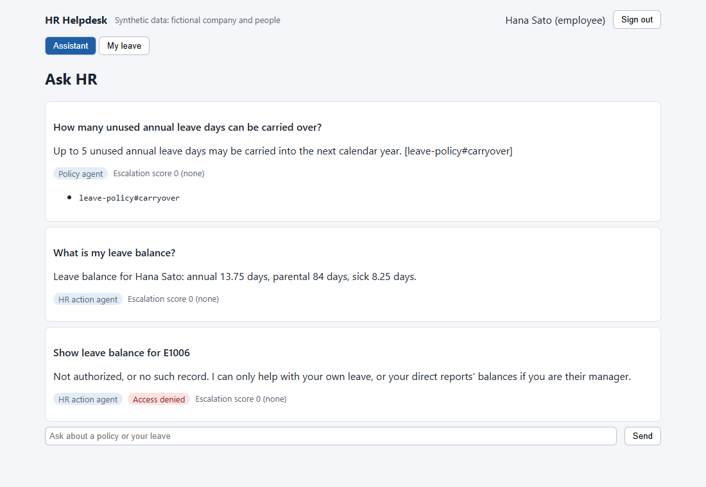
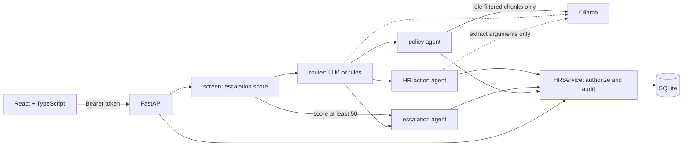

# hr-helpdesk-portal

An internal HR helpdesk over **fictional** policies and **fictional** employees. A React + TypeScript portal talks to
a FastAPI + SQLite backend. A LangGraph workflow routes each message to a policy-answer agent (RAG with citations),
an HR-action agent (leave balance and leave requests) or a human escalation. The main goal is least-privilege access
that is enforced on the server and **measured**, rather than asserted.

**Status: local only so far.** The GitHub repository, CI runs, pull requests and LLM evaluation have not happened yet
(see [Not done yet](#not-done-yet)).



The screenshot is the real app in `rules` mode (no LLM), taken with headless Chrome on localhost.

## Architecture



- **Identity** comes only from a signed token. Neither the request body nor the model can set it.
- **Roles** (employee, manager, HR) grant scopes in `backend/app/authz.py`.
- **Service accounts**: each agent has its own scope ceiling, and its effective permission is the intersection with the
  user's. An HR user therefore cannot read arbitrary employees through the chat agent, only through the audited portal path.
- **Human approval**: no agent account holds a decide scope, so an agent can only file a pending request. Sick, parental
  and unpaid leave, and annual leave over 10 working days, go to HR. Nobody can approve their own request.
- **Data minimisation**: a manager never sees the reason on an HR-routed request. Replies from the HR-action agent are
  templated, so the LLM never sees employee records.
- **Audit**: every authorization decision writes a row. SQLite triggers reject UPDATE and DELETE. Chat text is not logged.
- **Escalation scoring** (`backend/app/escalation.py`): a deterministic 0-100 score that runs before any LLM and can
  override the router. The weights are hand-set judgement calls.

Docs: [user stories with tests](docs/user_stories.md), [incident runbook](docs/runbooks/incident.md),
[operations runbook](docs/runbooks/operations.md).

## Run it

```bash
python -m venv .venv && source .venv/Scripts/activate   # bin/activate on Linux/macOS
pip install -r backend/requirements.txt
cd frontend && npm ci && npm run build && cd ../backend
HR_STATIC_DIR=../frontend/dist uvicorn app.asgi:app --port 8000
# open localhost:8000, password demo-only (fictional demo users)

# Optional, with local models:
ollama pull qwen2.5:3b && ollama pull nomic-embed-text
HR_LLM_MODE=ollama HR_STATIC_DIR=../frontend/dist uvicorn app.asgi:app --port 8000
```

Tests: `pytest -q` in `backend/`, `npm test` in `frontend/`.
Evaluation: `python -m evals.run_eval --mode rules --out evals/results/rules.json --thresholds evals/thresholds.json`.

## Measured results

**Conditions:** `rules` mode (keyword router, BM25, extractive answers, **no LLM**), run on the development laptop
(Windows 11, Python 3.11.5), on 2026-11-08 local time. Results: `backend/evals/results/rules.json`.
**LLM results do not exist yet**, so nothing below describes qwen2.5.

### Authorization

| Test | Attempts | Leak rate | Other |
|---|---|---|---|
| REST matrix, every actor against every target | 420 (319 unauthorized) | **0 / 319 = 0%** | Over-blocking 0 / 101, audit coverage 420 / 420 |
| Chat attacks across employees | 108 | **0 / 108 = 0%** | 81 reached the HR tools and were denied; 27 were routed to the policy agent |
| Restricted documents | 12 | **0 / 12 = 0%** | Control: HR can read the same document |
| Negative control, REST, authorization off | 420 | 286 / 322 = 88.8% | Shows the detector can fire |
| Negative control, chat, authorization off | 108 | 61 / 108 = 56.5% | Shows the detector can fire |

The REST expectations come from an oracle in `evals/run_eval.py`, written separately from `app/authz.py`. A leak is a
success response to an unauthorized call, a canary or balance belonging to the victim in the output, or a request filed for the victim.

A 0% rate means none of these specific attempts leaked. It is not proof that no leak exists. With no LLM in this run,
the chat result says nothing yet about model-driven behaviour, although the design does not rely on the model for access control.

### Routing and answers (no-LLM baseline)

| Metric | Value | n |
|---|---|---|
| Routing accuracy | 0.905 | 42 |
| Recall: escalate / hr_action / policy | 0.917 / 0.786 / 1.0 | 12 / 14 / 16 |
| Fact accuracy | 1.0 | 33 |
| Citation hit rate / precision | 1.0 / 1.0 | 33 |
| Groundedness (lexical) | 1.0 | 33 |
| Correct abstention on unanswerable questions | **0.625** | 8 |

The perfect answer scores are expected and not impressive: extractive answers copy a sentence from the top-ranked
section, so they are grounded by construction, and the questions closely follow the policy wording. Abstention is
the real weakness: 3 of 8 unanswerable questions received an irrelevant answer. The routing evaluation also found a real
bug (a missed self-harm phrasing). It was fixed with a regression test, so the routing figure is slightly optimistic for that one case.

## Data

All data is synthetic and written for this project: Halcyon Ridge Logistics, its policies and its employees are
fictional. No third-party dataset is used. Models, when used, run locally through Ollama; no paid service is involved.

## Limitations

- Evaluation sets are small, hand-written by the same author as the code, and match the corpus wording.
- Groundedness is a lexical check (numbers and word overlap), not a judgement of meaning.
- Escalation matching uses keywords, so it misses paraphrases, such as "My boss insults me in front of everyone". Missing a
  serious report is the costliest error here, so an LLM or better classifier would need a measured evaluation before real use.
- Public holidays are not counted in working days, and chat is stateless across messages.
- SQLite triggers stop accidental or SQL-level tampering, not someone with write access to the file.
- There is no login rate limiting, SSO, MFA, paging for critical escalations, or production deployment. Tokens are held in memory.
- The manager/HR boundary uses direct reports only; there is no skip-level access.

## Not done yet

- **Repository and CI:** the repository has not been published, so the workflows in `.github/workflows/` have never run.
- **LLM evaluation:** `eval-llm.yml` is ready to run qwen2.5:1.5b and 3b, but no results exist.
- **Code review:** no pull requests or review comments exist yet. When they are added, they will be **self-reviews by the
  author and an AI coding agent, not peer reviews**. Current branches were merged locally without review.
