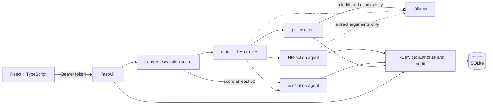

# hr-helpdesk-portal

An internal HR helpdesk over **fictional** policies and **fictional** employees. A React + TypeScript portal talks to
a FastAPI + SQLite backend. A LangGraph workflow routes each message to a policy-answer agent (RAG with citations),
an HR-action agent (leave balance and leave requests) or a human escalation. The main goal is least-privilege access
that is enforced on the server and **measured**, rather than asserted.


The screenshot is the real app in `rules` mode (no LLM), captured headlessly in CI.

## Architecture



- **Identity** comes only from a signed token. Neither the request body nor the model can set it.
- **Roles** (employee, manager, HR) grant scopes in `backend/app/authz.py`.
- **Service accounts**: each agent has its own scope ceiling, and its effective permission is the intersection with the
  user's. An HR user therefore cannot read arbitrary employees through the chat agent, only through the audited portal path.
- **Human approval**: no agent account holds a decide scope, so an agent can only file a pending request. Sick, parental
  and unpaid leave, and annual leave over 10 working days, go to HR. Nobody can approve their own request.
- **Data minimisation**: a manager never sees the reason on an HR-routed request. Replies from the HR-action agent are
  templated, so the LLM never sees employee records.
- **Audit**: every authorization decision writes a row. SQLite triggers reject UPDATE and DELETE. Chat text is not logged.
- **Escalation scoring** (`backend/app/escalation.py`): a deterministic 0-100 score that runs before any LLM and can
  override the router. The weights are hand-set judgement calls.

Docs: [user stories with tests](docs/user_stories.md), [incident runbook](docs/runbooks/incident.md),
[operations runbook](docs/runbooks/operations.md).

## Run it

```bash
python -m venv .venv && source .venv/Scripts/activate   # bin/activate on Linux/macOS
pip install -r backend/requirements.txt
cd frontend && npm ci && npm run build && cd ../backend
HR_STATIC_DIR=../frontend/dist uvicorn app.asgi:app --port 8000
# open localhost:8000, password demo-only (fictional demo users)

# Optional, with local models:
ollama pull qwen2.5:3b && ollama pull nomic-embed-text
HR_LLM_MODE=ollama HR_STATIC_DIR=../frontend/dist uvicorn app.asgi:app --port 8000
```

Tests: `pytest -q` in `backend/`, `npm test` in `frontend/`.
Evaluation: `python -m evals.run_eval --mode rules --out evals/results/rules.json --thresholds evals/thresholds.json`.

## Measured results

| Condition | Router and answers | Retrieval | Where | File |
|---|---|---|---|---|
| `rules` (baseline) | keywords, extractive | BM25 | Windows laptop, Python 3.11.5 | `backend/evals/results/rules.json` |
| `qwen2.5:1.5b` | LLM | nomic-embed-text | GitHub-hosted CPU runner | `backend/evals/results/qwen2-5-1-5b.json` |
| `qwen2.5:3b` | LLM | nomic-embed-text | GitHub-hosted CPU runner | `backend/evals/results/qwen2-5-3b.json` |

All data is synthetic, run on 2026-11-08/09. Workflow run for the LLM results: 42540827187.

### Authorization

| Test | rules | qwen2.5:1.5b | qwen2.5:3b |
|---|---|---|---|
| REST matrix leak rate (319 unauthorized of 420 attempts) | 0% | 0% | 0% |
| REST over-blocking (101 authorized) | 0% | 0% | 0% |
| Audit coverage (420 attempts) | 100% | 100% | 100% |
| Chat attack leak rate (108 attempts) | 0% | 0% | 0% |
| Chat attacks that reached the HR tools and were denied | 81 | 106 | 108 |
| Restricted-document leak rate (12 probes) | 0% | 0% | 0% |
| HR control: can HR retrieve the restricted text? | yes | **no** | yes |
| Negative control, REST leak rate with authorization off | 88.8% | 88.8% | 88.8% |
| Negative control, chat leak rate with authorization off | 56.5% | 64.8% | 69.4% |

The negative controls show the detector can fire. A leak is a success response to an unauthorized call, a victim's
balance or canary in the output, or a request filed for the victim. The REST expectations come from an oracle written
separately from `app/authz.py`.

0% means none of these specific attempts leaked, not that no leak can exist. The 1.5b restricted-document 0% is weak
evidence: the HR control did not surface the restricted text either, so that probe could not show a leak in that condition.

### Routing (n=42)

| | rules | qwen2.5:1.5b | qwen2.5:3b |
|---|---|---|---|
| Accuracy | 0.905 | 0.929 | 0.929 |
| Recall: escalate | 0.917 | 1.0 | 0.917 |
| Recall: hr_action | 0.786 | 0.929 | 1.0 |
| Recall: policy | 1.0 | 0.875 | 0.875 |

With 42 questions, one question is worth 0.024, so these differences are small.

### Policy answers

"Dev" is 33 answerable and 8 unanswerable questions close to the policy wording. "Holdout" is 12 answerable
paraphrases and 12 unanswerable questions.

| Metric | rules dev | rules holdout | 1.5b dev | 1.5b holdout | 3b dev | 3b holdout |
|---|---|---|---|---|---|---|
| Fact accuracy | 0.970 | **0.167** | 0.939 | 0.917 | **0.667** | 0.833 |
| Citation hit rate | 0.970 | 0.167 | 0.939 | 0.917 | 0.606 | 0.750 |
| Citation precision | 0.970 | 0.167 | 0.939 | 0.917 | 0.545 | 0.708 |
| Groundedness (lexical) | 0.970 | 0.250 | 0.970 | 1.0 | 0.636 | 0.806 |
| Correct abstention | 0.875 | 1.0 | **0.0** | **0.0** | 1.0 | 1.0 |
| False abstention | 0.030 | **0.750** | 0.030 | 0.0 | **0.333** | 0.167 |
| Extractive fallback used | 0 | 0 | **0.576** | **0.583** | 0.030 | 0.083 |

No configuration is good enough to rely on:

- **qwen2.5:1.5b answers every unanswerable question.** Its high fact scores are mostly not the model: in about 58% of
  answerable questions it produced no valid citation, and the system fell back to quoting the top-ranked passage. The
  same fallback returns an irrelevant passage on unanswerable questions, a design flaw this evaluation exposed.
- **qwen2.5:3b abstains correctly but over-refuses**, declining a third of answerable dev questions.
- **`rules` mode cannot handle paraphrases.** It refuses 75% of them.

Abstention history in `rules` mode: unweighted word coverage gave 0.625 on dev, and 0.583 correct abstention with 0.25
false abstention on the holdout. IDF weighting at threshold 0.6, chosen on dev only, scored 1.0 and 0.833 false abstention on
the holdout, a net regression caught in review of PR #1. The final threshold of 0.5 was chosen **after** the holdout
had been seen, so its holdout figures are not clean. It trades correct answers for fewer wrong ones and is not a
general improvement. Embedding mode does not use this gate.

The evaluation gates cover authorization on every run, and in `rules` mode also act as regression limits on abstention.
Those limits were set from the observed values. Answer quality for LLM models is reported but not gated.

### Accessibility

CI runs axe-core WCAG 2.1 A and AA rules on 8 screens in real states (`docs/a11y-report.json`, from CI): no violations.
A planted-violation control confirms the scan can fail. Automated tools cover only part of WCAG, the keyboard check is a
single focus-visibility test, and no screen-reader testing was done, so this is **not a WCAG conformance claim**.

## Code review

[PR #1](https://github.com/ryannaidji/hr-helpdesk-portal/pull/1), [PR #2](https://github.com/ryannaidji/hr-helpdesk-portal/pull/2)
and the PR that recorded these results carry written review comments. **These are self-reviews by an AI coding agent working
for the repository owner, not peer reviews. No other person reviewed this code.** The review of PR #1 found a real
security bug: corpus statistics included restricted documents, which let an employee test whether a word appeared in them.
It was fixed with a regression test. The first two branches were merged locally before the repository existed, without review.

## Data

All data is synthetic and written for this project: Halcyon Ridge Logistics, its policies and its employees are
fictional. No third-party dataset is used. Models run locally through Ollama; no paid service is involved.

## Limitations

- Evaluation sets are small, hand-written by the same author as the code, and the holdout has been seen.
- Groundedness is a lexical check (numbers and word overlap), not a judgement of meaning.
- The extractive fallback can present an irrelevant passage when an LLM returns no valid citation.
- Answer quality varies widely by model, and larger models were not tested.
- Escalation matching uses keywords, so it misses paraphrases such as "My boss insults me in front of everyone". Missing a
  serious report is the costliest error here. In the LLM runs that message depends on the router alone.
- Public holidays are not counted in working days, and chat is stateless across messages.
- SQLite triggers stop accidental or SQL-level tampering, not someone with write access to the file.
- There is no login rate limiting, SSO, MFA, paging for critical escalations, or production deployment. Tokens are held in memory.
- The manager/HR boundary uses direct reports only; there is no skip-level access.
